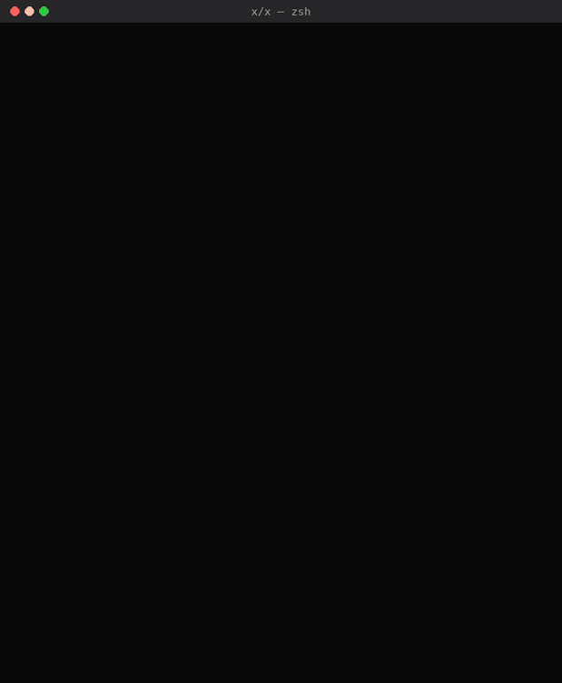

<p align="center">
  
</p>

<h1 align="center">x/x</h1>

<p align="center">
  A terminal security &amp; maintenance toolkit for macOS.<br>
  Everything runs locally. Nothing is deleted without asking you.
</p>

<p align="center">
  <a href="LICENSE"></a>
  
  
</p>

---

## Install

**Homebrew (recommended)**

```sh
brew tap kemal-uep/tap
brew trust kemal-uep/tap
brew install kemal-uep/tap/uep
```

**Git**

```sh
git clone https://github.com/kemal-uep/x-x.git ~/uep
ln -sf ~/uep/uep /opt/homebrew/bin/uep
brew install clamav yara   # only needed for virus scans
```

Then run:

```sh
uep
```

## What it does

| # | Module | What it does |
|---|--------|--------------|
| 1 | Security check | FileVault, firewall, Gatekeeper, XProtect version and age, SIP, auto updates, login settings, remote access ports, app signatures (apps and startup items not approved by Apple), apps listening on the network |
| 2 | Startup watch | Tracks launch agents, daemons and cron jobs. Shows what is new, changed or removed since last time. Dead entries (their program was deleted) are listed separately and can be moved to the Trash if you choose, with undo |
| 3 | Config file guard | Watches `.zprofile`, `.zshrc`, `/etc/hosts`, SSH keys, `.npmrc`, pip config and more. Flags suspicious lines like `curl … \| sh` |
| 4 | System report | Battery health, disk space, biggest folders, Trash, Time Machine |
| 5 | Virus scan | Quick or full scan with two engines at once: ClamAV, plus Apple's own Mac malware rules (XProtect, via `yara`; recompiled automatically when Apple updates them). The XProtect engine only reads programs and scripts, so it stays fast and also covers caches and the Trash. ClamAV's database updates automatically; the full scan uses every CPU core. Skips cloud folders (iCloud, Dropbox, Google Drive), the Photos library, `node_modules` and `.git`. Each hit shows whose file it is, who signed it and a recommendation; quarantine one by one or all at once. Nothing is deleted |
| 6 | Quarantine | Infected files are moved, not deleted. Restore or delete them later |
| 7 | Update | Homebrew packages, virus database, macOS update check |
| 8 | Full report | Runs 1–4 in one go and saves a report |
| 9 | Leftover cleaner | Finds files left behind by apps you **already uninstalled**. Never touches installed apps. Moves to Trash, with undo. Also uninstalls an app with its leftovers: finds it anywhere on the Mac (games in `~/Games` included, with their whole folder) and offers the same developer's leftovers (e.g. a launcher) as an opt-in extra, only when no other app from that developer is installed |
| r | Reports | Read or delete saved reports. Reports are deleted automatically after 7 days |

Press `⌫` on any screen to go back.

**Languages:** English and Turkish. The first launch asks which one you want. Press `L` in the main menu to switch any time.

<p align="center">
  
  
</p>

## Safety

- **Nothing is deleted without your confirmation.** Infected files go to quarantine, leftovers go to the Trash, and both can be undone.
- **The leftover cleaner is evidence-based.** A file is only offered when the app it belongs to is gone. Installed apps, Apple files and cloud folders (iCloud, Dropbox, Google Drive) are never touched.
- **No telemetry.** The only network traffic is Homebrew, the ClamAV database update and Apple's own update check.
- Logs and reports stay on your Mac: `~/.x-x` (Homebrew) or the clone folder (Git).

## Requirements

- macOS (Apple Silicon or Intel)
- zsh (default on macOS)
- [ClamAV](https://www.clamav.net/) for virus scans (installed automatically with Homebrew)
- [YARA](https://virustotal.github.io/yara/) to run Apple's XProtect rules (`brew install yara`)

## License

[MIT](LICENSE)

---

<details>
<summary><b>Türkçe</b></summary>

## x/x

macOS için terminalde çalışan güvenlik ve bakım aracı. Her şey bilgisayarında çalışır. Sana sormadan hiçbir şeyi silmez.

### Kurulum

```sh
brew tap kemal-uep/tap
brew trust kemal-uep/tap
brew install kemal-uep/tap/uep
```

Çalıştır:

```sh
uep
```

### Menü

| # | Bölüm | Ne yapar |
|---|-------|----------|
| 1 | Güvenlik kontrolü | FileVault, güvenlik duvarı, Gatekeeper, XProtect, SIP, oturum, uzaktan erişim, uygulama imzaları (Apple onaysız uygulama ve açılış öğeleri) |
| 2 | Başlangıç takibi | Açılışta çalışan öğeleri izler, yeni / değişen / kaldırılanı gösterir. Programı silinmiş ölü kayıtları ayrıca gösterir, istersen Çöp Kutusu'na taşır (geri alınabilir) |
| 3 | Ayar dosyası bekçisi | `.zprofile`, `hosts`, SSH anahtarları vb. değişikliklerini gösterir |
| 4 | Sistem raporu | Pil, disk, yedek |
| 5 | Virüs taraması | İki motor aynı anda: ClamAV ve Apple'ın Mac'e özel virüs kuralları (XProtect, `yara` ile; Apple güncelleyince kendiliğinden yenilenir). XProtect motoru sadece program ve script'leri okur, bu yüzden hızlıdır; önbellek ve Çöp Kutusu'na da bakar. Bulut klasörleri (iCloud, Dropbox, Google Drive), Fotoğraflar arşivi, `node_modules` ve `.git` atlanır. Her bulgunun altında kimin dosyası olduğu, imzası ve tavsiye yazar; karantinaya tek tek ya da hepsi birden alınır. Hiçbir şey silinmez |
| 6 | Karantina | Virüslü dosyaları geri yükle ya da kalıcı sil |
| 7 | Güncelle | Homebrew, virüs listesi, macOS |
| 8 | Tam rapor | 1-4'ü art arda çalıştırır |
| 9 | Kalıntı temizleyici | Silinmiş uygulamaların kalıntılarını bulur, Çöp Kutusu'na taşır. Uygulamayı kalıntılarıyla da kaldırır: Mac'in her yerinde bulur (`~/Games` içindeki oyunlar klasörüyle birlikte), aynı firmanın kalıntılarını (ör. launcher) ayrıca önerir; firmanın başka uygulaması yüklüyse önermez |
| r | Raporlar | Kayıtlı raporları oku ya da sil. Raporlar 7 gün sonra kendiliğinden silinir |

Her ekranda `⌫` ile geri dönülür.

**Dil:** İngilizce ve Türkçe. İlk açılışta hangisini istediğin sorulur. Ana menüde `L` tuşuyla istediğin zaman değiştirebilirsin.

Kayıtlar ve raporlar bilgisayarında kalır: `~/.x-x` (Homebrew) ya da indirdiğin klasör (Git).

Lisans: MIT. Dileyen kullanabilir, değiştirebilir, paylaşabilir.

</details>
