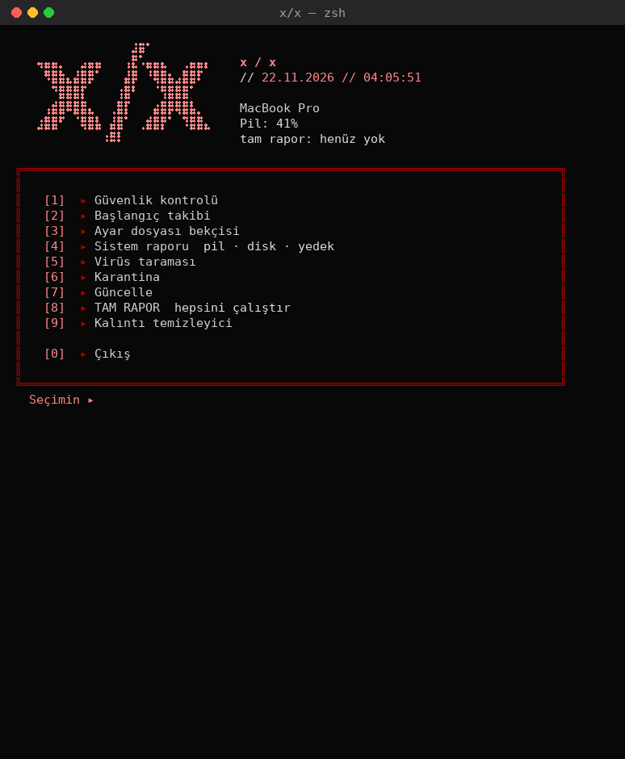
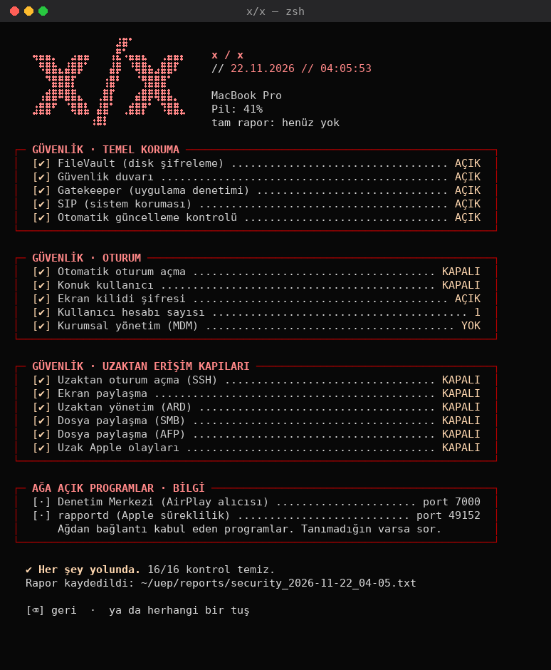

<p align="center">
  
</p>

<h1 align="center">x/x</h1>

<p align="center">
  A terminal security &amp; maintenance toolkit for macOS.<br>
  Everything runs locally. Nothing is deleted without asking you.
</p>

<p align="center">
  <a href="LICENSE"></a>
  
  
</p>

---

## Install

**Homebrew (recommended)**

```sh
brew install kemal-uep/tap/uep
```

**Git**

```sh
git clone https://github.com/kemal-uep/x-x.git ~/uep
ln -sf ~/uep/uep /opt/homebrew/bin/uep
brew install clamav        # only needed for virus scans
```

Then run:

```sh
uep
```

## What it does

| # | Module | What it does |
|---|--------|--------------|
| 1 | Security check | FileVault, firewall, Gatekeeper, SIP, auto updates, login settings, remote access ports, apps listening on the network |
| 2 | Startup watch | Tracks launch agents, daemons and cron jobs. Shows what is new, changed or removed since last time |
| 3 | Config file guard | Watches `.zprofile`, `.zshrc`, `/etc/hosts`, SSH keys, `.npmrc`, pip config and more. Flags suspicious lines like `curl … \| sh` |
| 4 | System report | Battery health, disk space, biggest folders, Trash, Time Machine |
| 5 | Virus scan | Quick or full scan with ClamAV. The virus database updates automatically. The full scan uses every CPU core (a temporary `clamd` that stops when the scan ends; falls back to single-core `clamscan` if it can't start). Skips caches, the Photos library, `node_modules` and `.git` — skipped folders are only not scanned, nothing is deleted |
| 6 | Quarantine | Infected files are moved, not deleted. Restore or delete them later |
| 7 | Update | Homebrew packages, virus database, macOS update check |
| 8 | Full report | Runs 1–4 in one go and saves a report |
| 9 | Leftover cleaner | Finds files left behind by apps you **already uninstalled**. Never touches installed apps. Moves to Trash, with undo |

Press `⌫` on any screen to go back.

**Languages:** English and Turkish. The first launch asks which one you want. Press `L` in the main menu to switch any time.

<p align="center">
  
  
</p>

## Safety

- **Nothing is deleted without your confirmation.** Infected files go to quarantine, leftovers go to the Trash, and both can be undone.
- **The leftover cleaner is evidence-based.** A file is only offered when the app it belongs to is gone. Installed apps, Apple files and cloud folders (iCloud, Dropbox, Google Drive) are never touched.
- **No telemetry.** The only network traffic is Homebrew, the ClamAV database update and Apple's own update check.
- Logs and reports stay on your Mac: `~/.x-x` (Homebrew) or the clone folder (Git).

## Requirements

- macOS (Apple Silicon or Intel)
- zsh (default on macOS)
- [ClamAV](https://www.clamav.net/) for virus scans (installed automatically with Homebrew)

## License

[MIT](LICENSE)

---

<details>
<summary><b>Türkçe</b></summary>

## x/x

macOS için terminalde çalışan güvenlik ve bakım aracı. Her şey bilgisayarında çalışır. Sana sormadan hiçbir şeyi silmez.

### Kurulum

```sh
brew install kemal-uep/tap/uep
```

Çalıştır:

```sh
uep
```

### Menü

| # | Bölüm | Ne yapar |
|---|-------|----------|
| 1 | Güvenlik kontrolü | FileVault, güvenlik duvarı, Gatekeeper, SIP, oturum, uzaktan erişim |
| 2 | Başlangıç takibi | Açılışta çalışan öğeleri izler, yeni / değişen / kaldırılanı gösterir |
| 3 | Ayar dosyası bekçisi | `.zprofile`, `hosts`, SSH anahtarları vb. değişikliklerini gösterir |
| 4 | Sistem raporu | Pil, disk, yedek |
| 5 | Virüs taraması | ClamAV ile hızlı ya da tam tarama. Tam tarama tüm işlemci çekirdeklerini kullanır, açılamazsa tek çekirdekle devam eder. Önbellek, Fotoğraflar arşivi, `node_modules` ve `.git` atlanır: sadece taranmaz, hiçbir şey silinmez |
| 6 | Karantina | Virüslü dosyaları geri yükle ya da kalıcı sil |
| 7 | Güncelle | Homebrew, virüs listesi, macOS |
| 8 | Tam rapor | 1-4'ü art arda çalıştırır |
| 9 | Kalıntı temizleyici | Silinmiş uygulamaların kalıntılarını bulur, Çöp Kutusu'na taşır |

Her ekranda `⌫` ile geri dönülür.

**Dil:** İngilizce ve Türkçe. İlk açılışta hangisini istediğin sorulur. Ana menüde `L` tuşuyla istediğin zaman değiştirebilirsin.

Kayıtlar ve raporlar bilgisayarında kalır: `~/.x-x` (Homebrew) ya da indirdiğin klasör (Git).

Lisans: MIT. Dileyen kullanabilir, değiştirebilir, paylaşabilir.

</details>
